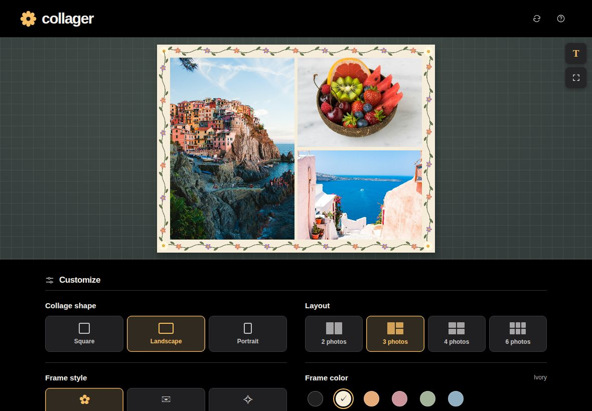

# Collager

Turn two, three, four, or six photos into a framed collage in your browser. Your photos stay on your device.

Website: collager.aak.sh



Start with the sample photos or add your own. Choose a square, landscape, or portrait canvas, pick a frame and color, then download a PNG with a 2400-pixel long edge. Save your collage before reloading or closing the tab.

## Local development

From the `collager/` directory, start the Python 3 preview server and open <http://127.0.0.1:4183>.

```sh
python3 site/preview.py
```

Edit the files in `site/public/` and reload the browser to see your changes. The same files are ready to publish without a build step. Use HTTPS when exposing the preview through a tunnel.

## Publish

Publish the contents of `site/public/` at `https://collager.aak.sh/` using any static host. The editor needs no API, database, or sign-in. For Caddy, deploy the `site/` directory to `/srv/aak.sh/collager/site/` and import `/srv/aak.sh/collager/site/Caddyfile` from the main Caddyfile. Reload Caddy after pointing the subdomain at the host. The site block serves `public/` directly. If publishing on another domain, update the absolute URLs in `index.html`, `sitemap.xml`, and `robots.txt`.

Increment `collager-version` in `site/public/index.html` for each release and use the same number in the `?v=` query on local JavaScript and CSS references, including module imports. Serve the public files with `Cache-Control: no-cache` so browsers revalidate them on reload. The header refresh button turns green when the deployed version differs from the open editor.

On HTTPS, **Share collage** passes the PNG to the device share sheet when file sharing is available. **How to use → Add to Home Screen** opens the install prompt or gives browser-specific steps.

## Sample photography

The bundled travel photos are sourced from Unsplash. The editor loads them locally.

- [Coastal village](https://images.unsplash.com/photo-1516483638261-f4dbaf036963)
- [Fruit bowl](https://images.unsplash.com/photo-1519996529931-28324d5a630e)
- [Seaside steps](https://images.unsplash.com/photo-1533105079780-92b9be482077)
- [Italian coast](https://images.unsplash.com/photo-1499678329028-101435549a4e)
- [Mountain lake](https://images.unsplash.com/photo-1476514525535-07fb3b4ae5f1)
- [Mountain valley](https://images.unsplash.com/photo-1472396961693-142e6e269027)
